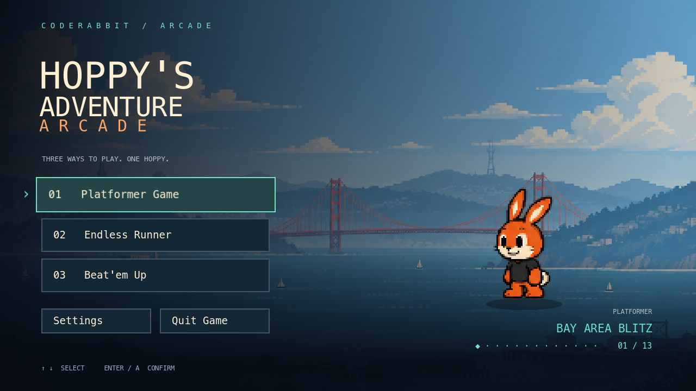

# Hoppy’s Adventure Arcade

[](https://github.com/coderabbitai/coderabbit-arcade/actions/workflows/ci.yml)
[](LICENSE)
[](https://godotengine.org/)

A Godot 4 arcade collection starring Hoppy, the CodeRabbit mascot. It has a reactive main menu, three Platformer levels (**Bay Area Blitz**, **Orbital Ops** and **The Enchanted Repo**) and the **Endless Runner** (The Codebase Corridor). The Beat’em Up includes playable v1 modes: [Code City Brawl](docs/code-city-brawl.md) and [Heroes vs. Villains](docs/heroes-vs-villains.md), with three stages each.



## Play

1. Install [Godot **4.7.1**](https://godotengine.org/download/archive/) (standard build).
2. Open `hoppys-adventure-arcade/project.godot` and press **F5**, or run:
   ```sh
   godot --path hoppys-adventure-arcade
   ```
3. Choose **Platformer Game → Level Select**, **Endless Runner**, or **Beat’em Up → Play Code City Brawl / Play Heroes vs. Villains**.

| Action | Keyboard | Controller |
|---|---|---|
| Move | A/D or arrow keys | Left stick / D-pad |
| Jump | Space | A / Cross |
| Attack | J / X | X / Square |
| Pause | Escape | Start |

In Orbital Ops' zero-gravity bay, hold Jump or Up to rise, hold Down to descend, and release to brake.

## Builds

Versioned macOS, Windows, Linux and Web builds come from the [Build workflow](.github/workflows/build.yml): releases for `v*` tags, artifacts for every `main` push, and preview builds for PRs labelled `preview-build`. To build locally, run `python3 tools/build/export_game.py --smoke`. See [docs/builds.md](docs/builds.md).

### Run it at a booth

To run a build as an unattended kiosk, pass `--booth` after `--`. Add `--route=<name>` to open a game straight away:

```sh
open -a "Hoppy’s Adventure Arcade.app" --args -- --booth --route=heroes_vs_villains   # macOS
HoppysAdventureArcade.exe -- --booth --route=heroes_vs_villains                       # Windows
./HoppysAdventureArcade.x86_64 -- --booth --route=heroes_vs_villains                  # Linux
```

Booth mode runs fullscreen and ignores the menu's **Quit Game**, so staff close the window instead. After 90 seconds without input, any game returns to the hub's attract screen. [Run it at a booth](docs/builds.md#run-it-at-a-booth) lists every route and flag.

## Docs

- Platformer: [Bay Area Blitz](docs/bay-area-blitz.md), [Orbital Ops](docs/orbital-ops.md), [The Enchanted Repo](docs/enchanted-repo.md)
- [Endless Runner](docs/endless-runner.md): how to run it, asset budgets, verification. See also its [contract](docs/endless-runner-contract.md) and [systems](docs/endless-runner-systems.md).
- [Code City Brawl](docs/code-city-brawl.md): controls, combat, stages, audio and verification.
- [Heroes vs. Villains](docs/heroes-vs-villains.md): controls, capabilities, four villains, audio and verification.
- [Heroes vs. Villains asset pack](docs/heroes-vs-villains-assets.md): Mode 2 art, boss moveset catalog and Godot previews; assets only.
- [Main menu / arcade hub](docs/main-menu.md)
- [Soundtrack plan](docs/soundtrack.md): the theme song, its 8-bit derivatives, level music and how to produce and deliver them.

## Tests

```sh
python3 tools/tests/run_tests.py --godot /path/to/Godot
```

CI discovers the suites in `hoppys-adventure-arcade/tests/`: every script that extends `SceneTree` or `MainLoop`. Helpers such as `tests/support/` are not suites. It runs all of them on every PR, except the few listed with a reason in [`tools/tests/suites.toml`](tools/tests/suites.toml). A suite fails on a nonzero exit, an engine or script error, or a leak. See [CONTRIBUTING.md](CONTRIBUTING.md#tests) for details.

## Contributing

Contributions are welcome. Please read [CONTRIBUTING.md](CONTRIBUTING.md) and our [Code of Conduct](CODE_OF_CONDUCT.md). To report a security issue, see [SECURITY.md](SECURITY.md).

## License

- Code: [MIT](LICENSE)
- Assets: individual licenses; see [ASSETS_LICENSES.md](ASSETS_LICENSES.md)
- The CodeRabbit name and the Hoppy mascot are trademarks; see [TRADEMARKS.md](TRADEMARKS.md)
