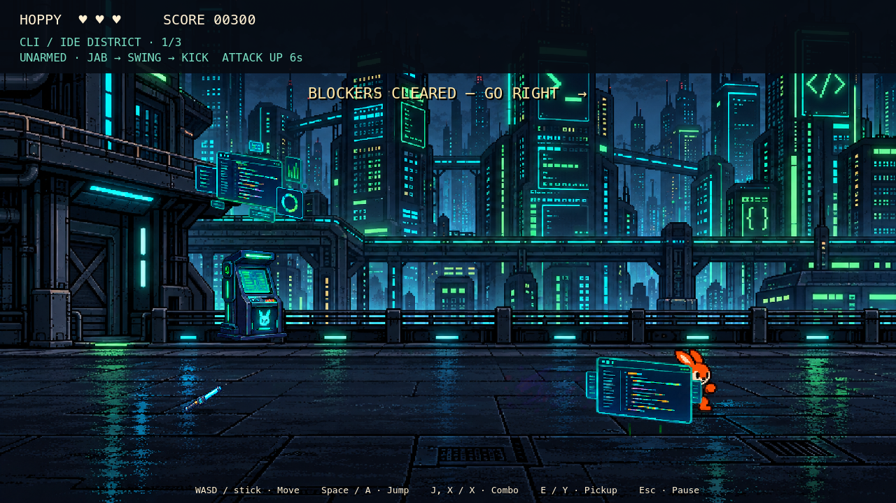

# Code City Brawl — playable v1

Launch Godot 4.7.1 and choose **Beat'em Up → Play Code City Brawl** from the arcade hub. The mode route is `code_city_brawl`; the entry scene is `scenes/beatem_up/code_city_brawl.tscn`.



## Controls and progression

| Action | Keyboard | Controller |
|---|---|---|
| Move along street / change depth lane | WASD / arrows | Left stick / D-pad |
| Jump | Space | A / Cross |
| Attack; chain jab → swing → spinning kick | J or X | X / Square |
| Pick up nearby weapon | E or K | Y / Triangle |
| Pause / resume | Escape | Start |

W/Up changes the ground lane. Jump is a separate height above that lane. Attacks have a forward reach and depth tolerance, so standing in another lane avoids melee. Jump above ground attacks and projectiles, or sidestep their telegraphs. Late attack input buffers one next combo step; a gap of more than 0.48 seconds after recovery resets the chain.

Hoppy has three HP. Coffee restores one HP. Each stage begins with fresh health and equipment. Defeat offers a retry from that stage's first encounter, restoring the score saved on entry. Pause freezes combat, effects and music; losing window focus also pauses. Return-to-menu is available from pause, intros and results.

There are three gated encounters per district. Clear every living combatant, including split soldiers and reviving zombies, then walk right. The ninth encounter is the boss. A skippable three-panel introduction opens the run; stage transitions and the Force Merge ending complete it. Mode 2 remains unavailable.

## Districts and combat

| Stage | Enemy roster | Environment |
|---|---|---|
| CLI/IDE District | CLI Gremlin, Syntax Error Sprite, armored Linter Enforcer | Breakable kiosks and IDEs; telegraphed falling Injection Bombs |
| Security Sector | CVE Crawler, Injection Attack Drone, Dependency Bot | Breakable servers and crates; scanner columns and server breach shockwaves |
| Git Repository HQ | Merge Conflict Soldier, Force Push Bandit, Stale Branch Zombie | Breakable pillars and scaffolding; Detached HEAD traps and projectile lanes |

Enemies telegraph before attacking. The Crawler can dodge, the Drone fires a spread, and Bandits charge. The first hit on a Linter breaks armor and removes one HP. Soldiers split once; their copies cannot split again. A Zombie's first defeat leaves it registered with the encounter until it rises; the second defeat is permanent.

CR Bot supplies an Approval Shield, the Linting Fairy supplies speed, and Senior Dev supplies coffee. Props also release weapons, tokens, boosts and occasional debuffs. Approval Shield absorbs one hit; Confused reverses movement, Slow reduces speed, and Strength Down reduces attack damage. Temporary statuses expire independently; recollecting the same effect refreshes its timer.

| Weapon | Durability | Behavior |
|---|---:|---|
| Debug Stick | 5 | Two-damage strike |
| Linter Staff | 8 | Wide sweep across nearby lanes |
| API Key Whip | 6 | Long reach |
| Git Branch | 4 | Strong knockback |
| Firewall Shield | 3 | Absorbs three hits while retaining the unarmed combo |
| Refactor Hammer | 3 | Slow, four-damage single-target strike |

Equipped weapons now chain three animated steps: thrusts and alternating sweeps for the stick/staff/branch, extension and recoil for the whip, and overhead/side swings for the hammer. The shield stays in guard during the unarmed combo and recoils on blocks. Hand-anchored weapon transforms, Hoppy poses and trails share the attack clock; contact occurs at 44% of the swing. Facing locks through each swing, and damage cancels the motion. These animations reuse the existing art without adding raster assets.

Weapons require the pickup action; consumables collect on contact. A successful offensive swing consumes one durability charge even if it hits multiple targets. Misses cost no charge. Breaking a weapon returns Hoppy to the unarmed combo. The hammer selects the first valid enemy in encounter order, then props if no enemy was hit; it is not a nearest-target lock-on system.

## The Grand Merge Conflict

The boss has 24 HP and exposes its core during recovery. Land the third unarmed combo hit or an offensive weapon strike during that opening. While exposed, the core adds 70 pixels of forward reach and 44 pixels of depth tolerance to the attack: an unarmed finisher reaches 180 pixels forward with ±90 pixels of lane tolerance (previously 110 / ±46). This forgiveness applies only to the boss during recovery; facing, finisher requirements and recovery timing are unchanged.

1. **Conflict Spawner:** pursues Hoppy, summons soldiers, then leaps into warned ground sweeps/slams.
2. **Split Screen (50% HP):** flanks to the other side between opposing projectile volleys, with a cyan/red screen divide.
3. **Merge Chaos (25% HP):** faster flanking, committed jumping slams, projectile storms with a safe lane, bounded reinforcements and mild screen distortion.

A leap commits to the warned destination; it does not follow Hoppy after takeoff. The ground warning includes the 0.65-second flight. Landings carry impact effects and camera feedback. Recovery keeps the boss still for 2.4 seconds in phase 1 and 2.1 seconds thereafter. Phase 3 holds the staggered `hurt` pose with a breathing animation, a pulsing core ring, and a persistent FINISHER cue. The ring drains from the same recovery timer used for vulnerability, freezes on pause, and clears on recovery exit or defeat. `core_exposure.gd` draws this cue over the existing art; no damage timing or hit area changes are tied to the visual. Phase transitions clear old threats and cancel travel. The final hit starts the automatic Force Merge jump/slam, resolves the core, awards 1,000 points and shows the result once.

## Audio and assets

| Area | Music in `Assets/Audio/Beat'em Up/` |
|---|---|
| CLI/IDE and mode menu | `Zodik - Future Travel.ogg` |
| Security | `helldrake(extended).ogg` |
| Git HQ | `kim_lightyear_-_angel_eyes_vision_ii.mp3` |
| Boss | `Kim Lightyear - The Final.mp3` |

Music uses independently duplicated looping streams on the Music bus. Ten reusable positional voices play punch, damage, pickup, jump and fanfare sounds from Juhani Junkala's Essential Retro collection on the SFX bus. Shared imported audio resources are not mutated.

The existing [Code City Brawl pack](code-city-brawl-assets.md) supplies environments, enemies, boss, items, weapons and effects. `Assets/code-city-brawl-player/` adds 16 Hoppy combat/depth-movement frames, plus the source image, exact generation prompt and atlas manifest. Side-running and death reuse the Platformer Hoppy resource. Repack the combat source with `tools/build_hoppy_brawler.py` (Pillow required). Licensing and provenance status are recorded in [ASSETS_LICENSES.md](../ASSETS_LICENSES.md).

## Implementation and verification

Runtime scripts are in `modes/beatem_up/`: `catalog.gd` owns immutable tuning and music mappings; `player.gd`, `enemy.gd` and `boss.gd` own instance state; `weapon_rig.gd` animates hand grips and trails from the player attack clock; `game.gd` owns encounters, UI, items, audio and cleanup. `art.gd` loads shared read-only SpriteFrames. Ground-plane geometry drives combat; jump height is separate from Y sorting. Encounters cap enemies at 12, projectiles at 32, warning areas at 12 and pickups at 24.

```sh
godot --headless --path hoppys-adventure-arcade --import
godot --headless --path hoppys-adventure-arcade --script res://tests/code_city_assets.gd
godot --headless --path hoppys-adventure-arcade --script res://tests/code_city_logic.gd
godot --headless --path hoppys-adventure-arcade --script res://tests/code_city_motion.gd
godot --headless --path hoppys-adventure-arcade --script res://tests/code_city_smoke.gd
# Rendered traversal and screenshots (macOS):
godot --path hoppys-adventure-arcade --always-on-top --script res://tests/code_city_smoke.gd
```

The logic suite covers combo buffering, attack deduplication and depth, weapon durability, armor, shields/statuses, hammer target count, soldier splits, zombie revival, gate ownership, pickup rules, hazard warnings, jumping, pause, boss thresholds, Force Merge, retry cleanup and all four music mappings. The smoke suite injects keyboard/gamepad events, traverses all nine encounters, verifies bounded pools and one completion, and returns to the menu. Rendered runs save previews in `docs/previews/code-city/`.

The traversal bot uses invulnerability to establish reachability; it does **not** validate difficulty balance. Physical controllers, exported builds and mobile/web targets have not been tested. This v1 uses three finite panoramic rooms per district with repeated scenery and curated enemy waves; prop bodies do not obstruct movement. Boss attacks use ground-plane hit geometry, not pixel-perfect sprite collision. These are explicit starting points for the next gameplay-tuning pass.

### Local validation — October 5, 2026

Godot 4.7.1: all 19 headless suites listed in CI passed, including the three Code City suites and the existing menu, Platformer and Runner checks. Runner persistence suites needed normal user-data write access after the sandbox blocked their temporary fixtures. The rendered Code City traversal also completed all nine encounters and returned to its menu; captured UI was inspected at 1280×720. Python atlas-tool compilation and `git diff --check` passed. Ruff was unavailable in the local runtime; CI remains the lint check. Godot's headless macOS certificate/editor-preference warnings and Runner logic shutdown resource warnings remain outside this mode's changes.

### Weapon animation and boss mobility follow-up

`code_city_motion.gd` checks all six equipped rigs, three-step chaining, mirrored grips, whip extension, hit interruption, shield recoil, boss pursuit/flanking, committed leap targets, landing recovery, bounds, and transition/death cleanup. Its rendered run captures weapon windup/contact/recovery and the boss leap in `docs/previews/code-city-motion/`. The full traversal bot now prioritizes the mobile boss instead of spending every opening on its renewable reinforcements. As before, bot completion is a reachability check with invulnerability, not a difficulty assessment.

Follow-up validation: existing Code City logic and asset checks passed; the new motion suite passed headlessly and with rendered pose captures. Both headless and rendered full traversals reached Force Merge with the moving boss. `git diff --check` passed. Difficulty still needs player feedback.

Phase 3 exposure polish: logic and motion regression tests passed, including both storm/clone recovery openings, full-window cue persistence, pause synchronization and defeat cleanup. The rendered motion test was inspected; its preview is `docs/previews/code-city-motion/boss_phase3_exposed.png`.
