# Code City Brawl — playable v1

Launch Godot 4.7.1 and choose **Beat'em Up → Play Code City Brawl** from the arcade hub. The mode route is `code_city_brawl`; the entry scene is `scenes/beatem_up/code_city_brawl.tscn`.


## Controls and progression

| Action | Keyboard | Controller |
|---|---|---|
| Move along street / change depth lane | WASD / arrows | Left stick / D-pad |
| Jump | Space | A / Cross |
| Attack; chain jab → swing → spinning kick | J or X | X / Square |
| Pick up nearby weapon | E or K | Y / Triangle |
| Pause / resume | Escape | Start |

W/Up changes the ground lane. Jump is a separate height above that lane. Attacks have a forward reach and depth tolerance, so standing in another lane avoids melee. Jump above ground attacks and projectiles, or sidestep their telegraphs. Late attack input buffers one next combo step; a gap of more than 0.48 seconds after recovery resets the chain. Hoppy keeps his facing through a swing, so its hit area never flips mid-attack. Pressing the other way during or right after a swing turns him for the next one, buffered combo steps included. A quick tap mid-swing is remembered until the swing ends.

Hoppy has three HP. Coffee restores one HP. Each stage begins with fresh health and equipment. Losing the last HP plays a knockout cinematic, the same in both brawler modes:
- A slow-motion throw under a camera push and letterbox bars, with the HUD, minimap and control hints hidden.
- Hoppy lying in the defeat pose with orbiting stars.
- A REVIEW FAILED card.

The sequence lasts about 3.5 seconds and restores the camera and HUD when it ends or is cancelled. The game-over menu then offers a retry from that stage's first encounter, restoring the score saved on entry. Pause freezes combat, effects and music, including during the introduction and stage transitions; losing window focus also pauses. Return-to-menu is available from pause, intros and results.

There are three gated encounters per district. Clear every living combatant, including split soldiers and reviving zombies, then walk right. In the first two districts, clearing the third encounter's wave calls in a [district boss](#district-bosses) instead of opening the gate. The ninth encounter is the Grand Merge Conflict. No confirm press is needed between stages:

- **Introduction.** Three painted story scenes open the run: Code City under siege, the review pipeline breached, and Hoppy clocking in on a rooftop over the districts.
  - Each scene slowly pans and zooms under letterbox bars while its caption types out, then dips to black.
  - Each turns by itself after 4.5 seconds while a bar in the lower letterbox drains.
  - In the lower bar, **Next →** turns a scene sooner, **Skip intro** goes straight to the first district, and **Return to Beat'em Up menu** leaves.
- **District boss down.** When a district boss falls, play stops and its adds and threats clear. Hoppy hops once in his victory pose under a DISTRICT BOSS DOWN banner (+500 points) for 1.4 seconds.
- **Stage exit and entry.** After the victory hop, Hoppy runs off to the right on his own under a DISTRICT SECURED banner. The screen dips to black while the next district loads, then he runs in under its title banner. The sequence takes about 2–3 seconds; the title banner stays up for 2.8 seconds and fades over the start of combat, and messages raised in that time (such as the encounter counter) wait until it clears. The first room's enemies wait 0.8 seconds before their first telegraph. Retry uses the same run-in.
- **Boss music** dips, swaps tracks at the bottom and comes back up over 0.6 seconds instead of cutting hard.
- **Celebration.** After the Force Merge finisher, a 5.2-second celebration plays:
  - Hoppy's three-frame victory cheer, confetti, a camera push and a MERGE SUCCESSFUL banner, with the HUD, minimap and control hints hidden until it ends.
  - The boss track ducks, and an original 3.5-second square-wave jingle plays once.
  - Then a 16.552-second F-major victory loop starts and continues through the ending pages and results.
  - Pause freezes the choreography and the jingle. Rebuilding the stage or leaving cancels the celebration.
- **Ending.** The celebration leads into a painted victory epilogue, and then the victory screen completes the run.
  - The epilogue is three story scenes, played like the introduction: the Grand Merge Conflict resolving, Code City coming back online, and Hoppy shipping it on a rooftop at sunrise.
  - Each scene holds for 5 seconds. **Next →** turns a scene sooner and **Skip** goes straight to the victory screen. Pause freezes the epilogue and resumes it on the same scene.
  - The victory screen counts the final score up from zero over 1.8 seconds and shows the time taken, then **Return to Beat'em Up menu** takes focus.
  - The victory screen and game-over menu ignore confirm, click and touch input for their first 0.5 seconds, so a jump or attack press carried over from combat can't select an option. After that, the first press lands the score count at once.
- **Minimap.** A minimap sits in the top-right corner, under the HUD bar and clear of the boss bar.
  - Its top row shows the whole run: all nine encounters as tiles, grouped by district. Cleared encounters are filled, the current one pulses, and the final boss encounter is marked.
  - Below that is the current encounter, with Hoppy, the enemies and the boss (a district boss too) as live dots over the depth band, and the gate (red while closed, dashed once open).
  - It hides during the story scenes, the victory screen, game over and while a stage title banner is up.

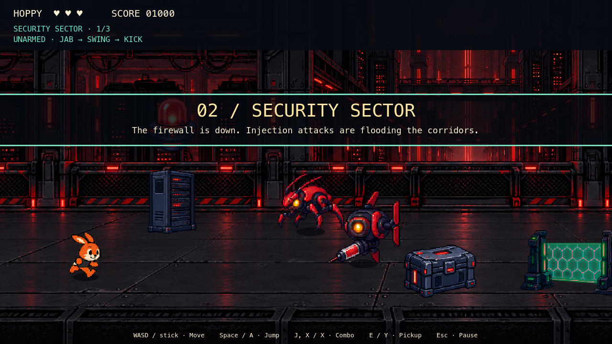

| Opening story scene | Knockout on the last HP |
|---|---|
| 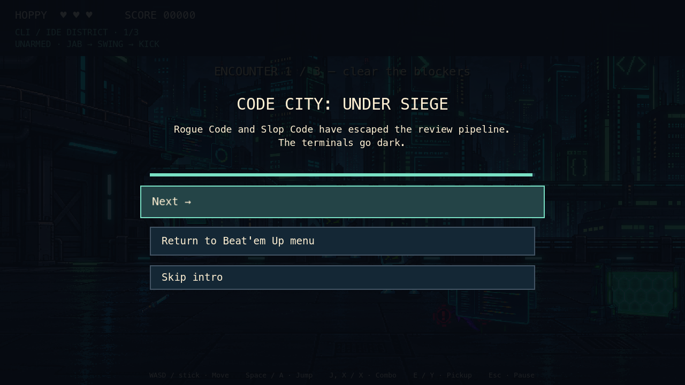 | 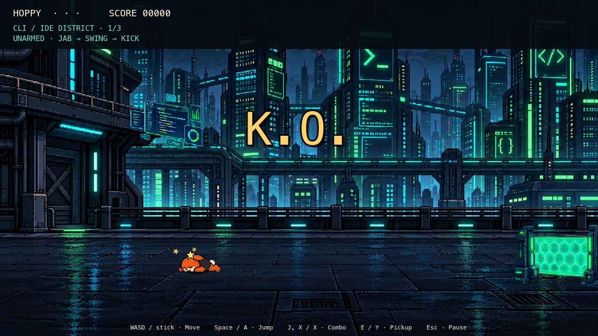 |

| District boss down | Running off to the next district | Celebration |
|---|---|---|
| 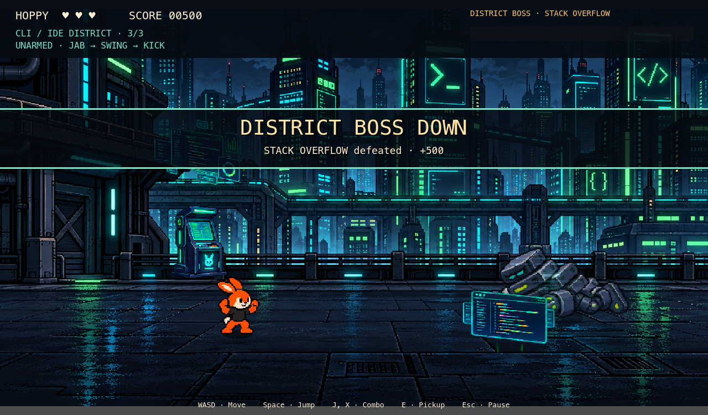 | 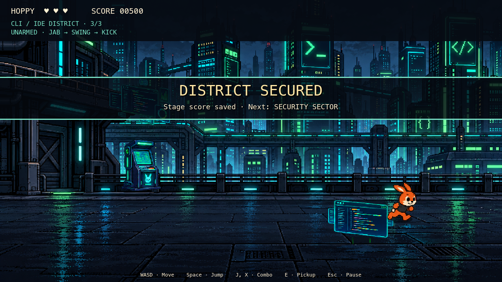 | 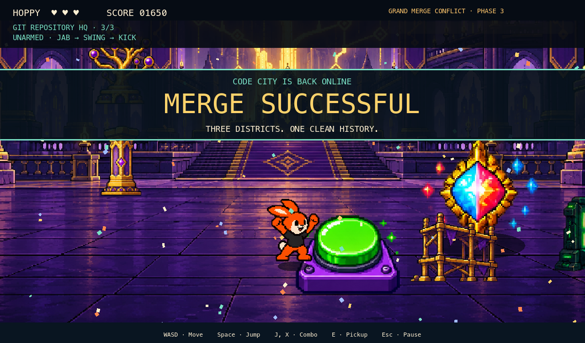 |

| Minimap | Victory epilogue | Victory screen |
|---|---|---|
| 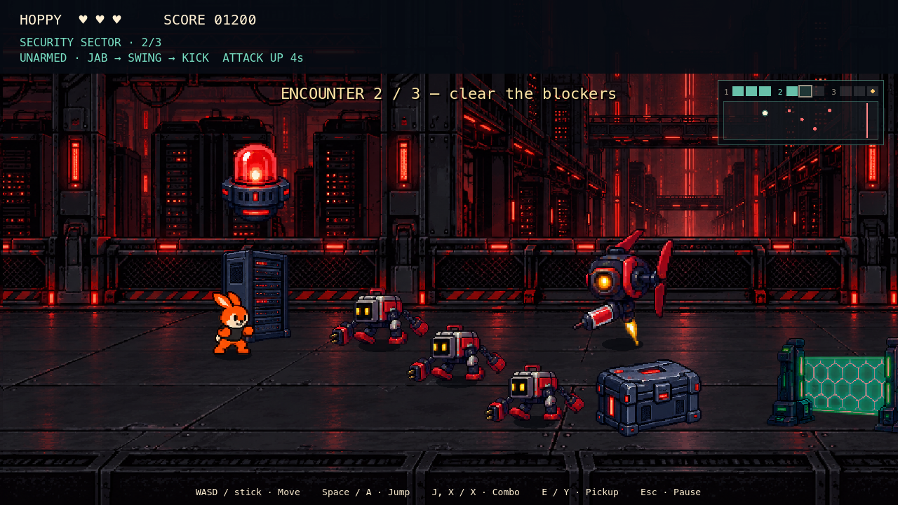 | 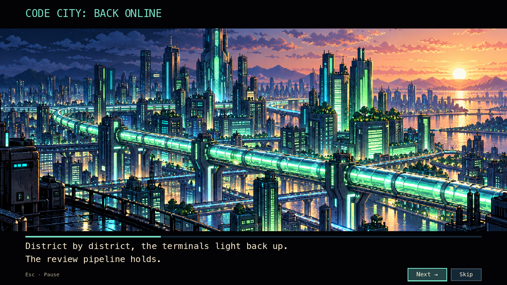 | 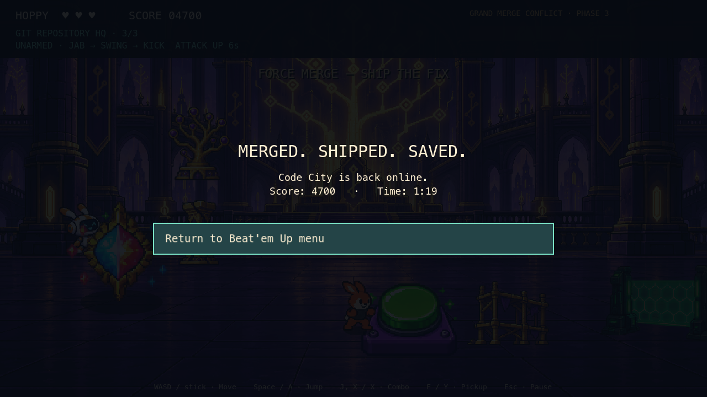 |

[Mode 2: Heroes vs. Villains](heroes-vs-villains.md) is separately playable from the mode menu.

## Districts and combat

| Stage | Enemy roster | Environment |
|---|---|---|
| CLI/IDE District | CLI Gremlin, Syntax Error Sprite, armored Linter Enforcer | Breakable kiosks and IDEs; telegraphed falling Injection Bombs |
| Security Sector | CVE Crawler, Injection Attack Drone, Dependency Bot | Breakable servers and crates; scanner columns and server breach shockwaves |
| Git Repository HQ | Merge Conflict Soldier, Force Push Bandit, Stale Branch Zombie | Breakable pillars and scaffolding; Detached HEAD traps and projectile lanes |

Enemies telegraph before attacking. The Crawler can dodge, the Drone fires a spread, and Bandits charge. The first hit on a Linter breaks armor and removes one HP. Soldiers split once; their copies cannot split again. A Zombie's first defeat leaves it registered with the encounter until it rises; the second defeat is permanent.

CR Bot supplies an Approval Shield, the Linting Fairy supplies speed, and Senior Dev supplies coffee. Props also release weapons, tokens, boosts and occasional debuffs. Approval Shield absorbs one hit; Confused reverses movement, Slow reduces speed, and Strength Down reduces attack damage. Temporary statuses expire independently; recollecting the same effect refreshes its timer.

| Weapon | Durability | Behavior |
|---|---:|---|
| Debug Stick | 5 | Two-damage strike |
| Linter Staff | 8 | Wide sweep across nearby lanes |
| API Key Whip | 6 | Long reach |
| Git Branch | 4 | Strong knockback |
| Firewall Shield | 3 | Absorbs three hits while retaining the unarmed combo |
| Refactor Hammer | 3 | Slow, four-damage single-target strike |

Each weapon has a baked sheet of Hoppy holding it, so grip, pixel scale and layering match the body in every frame. With a weapon equipped, idle, side running, pickup and hurt play the sheet's `hold_idle`, `run`, `equip` and `hurt` clips. Walking toward or away from the camera plays its `walk_down` or `walk_up` clip when the sheet has one. The three combo steps play `step1`–`step3`: thrusts and alternating sweeps for the stick, staff and branch; a crack, an extended lash and a recoil for the whip; overhead and side swings for the hammer. Each step shows a windup, contact or follow-through frame chosen from the attack clock. Contact occurs at 44% of the swing, inside the contact frame. The shield stays in guard during the unarmed combo and shows its block-recoil frame on blocks. Hits burst on the enemy; swing and miss effects start at the weapon tip (the sheet's contact-frame anchor), mirrored with facing, and a trail follows the contact frame. Poses with no armed frame (jumping, and walking toward or away from the camera on a sheet without those clips) draw a pixel-matched carry icon at Hoppy's paw. It draws behind the body in the back view and on jumps, where the paw is at his chin, and the shield also does so walking toward the camera, so no carry covers his face. Facing holds through each swing, and damage cancels the motion. Reach, timing, durability and damage are unchanged. A weapon without a sheet would fall back to the older hand-animated weapon cel.

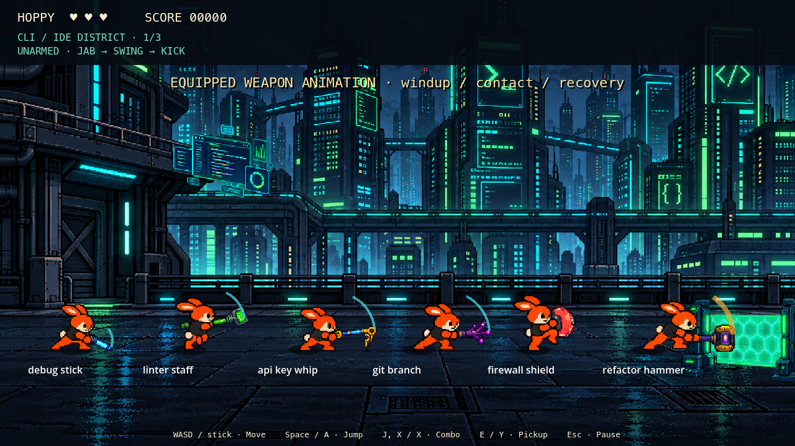

Weapons require the pickup action; consumables collect on contact. A successful offensive swing consumes one durability charge even if it hits multiple targets. Misses cost no charge. Breaking a weapon returns Hoppy to the unarmed combo. The hammer selects the first valid enemy in encounter order, then props if no enemy was hit; it is not a nearest-target lock-on system.

## District bosses

The first two districts end on a district boss instead of a gate. It is called in when the third encounter's wave is cleared, drops in on the right of the room and takes the boss bar (DISTRICT BOSS · name). The music dips into the district-boss fight track, and the district's stage hazards pause for the fight. The bar and its label clear as soon as the boss falls.

| District | Boss | HP | Adds below half HP |
|---|---|---:|---|
| CLI/IDE District | STACK OVERFLOW, a tottering tower of call-stack frames | 14 | Two CLI Gremlins |
| Security Sector | ZERO-DAY, a cloaked exploit knight | 18 | Two Dependency Bots |

- **No openings to wait for.** Every hit lands, and every fourth hit makes the boss reel for 0.6 seconds, dropping the move it was winding up.
- **Slam.** The boss winds up while a ground warning marks Hoppy's spot, leaps onto it and lands as the warning fires. A shot then runs along the lane in each direction. Jump the shots or change lanes.
- **Dash.** The boss lines up on Hoppy's lane behind a row of warning markers and charges across the room.
- **Enrage.** Below half HP its wind-ups are 20% shorter, and it calls in two adds, once.

Each boss has its own 16-frame sheet in the Code City pack (`stack_overflow`, `zero_day`), drawn at the enemies' scale so it stands about 1.6 times as tall as a Linter Enforcer. A boss whose sheet is missing from the pack manifest draws a stand-in at about twice that enemy's size instead: the Linter Enforcer for Stack Overflow and the Force Push Bandit for Zero-Day.

| Stack Overflow winding up a slam | Zero-Day winding up a slam |
|---|---|
| 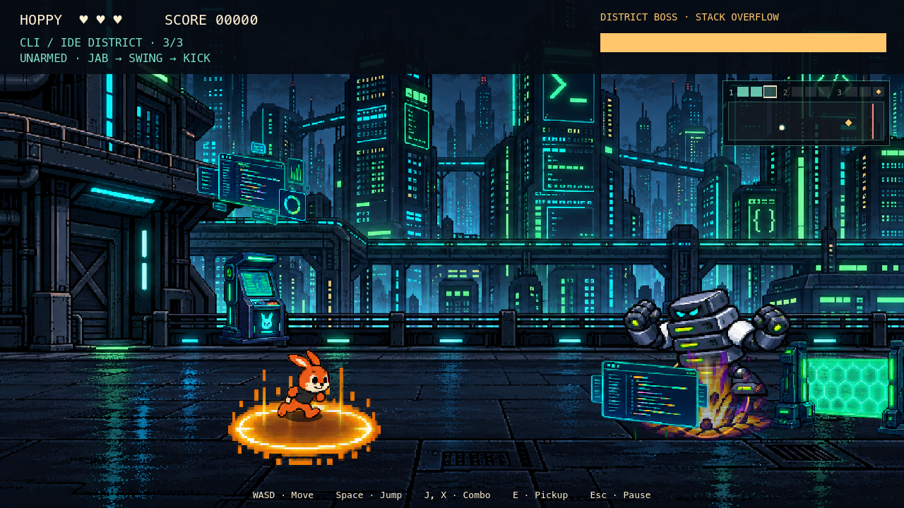 | 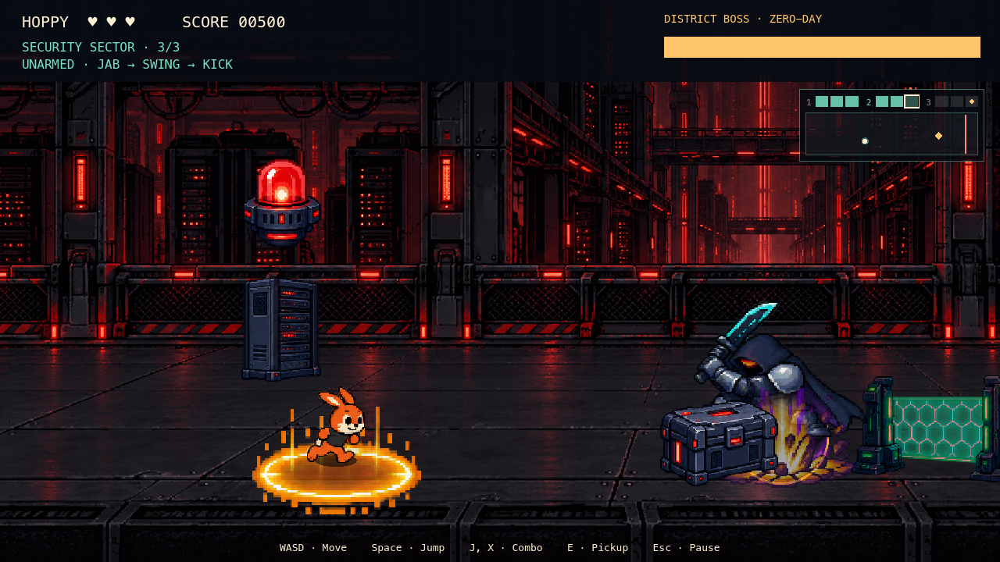 |

## The Grand Merge Conflict

The boss has 24 HP and exposes its core during recovery. Land the third unarmed combo hit or an offensive weapon strike during that opening. While exposed, the core adds 70 pixels of forward reach and 44 pixels of depth tolerance to the attack: an unarmed finisher reaches 180 pixels forward with ±90 pixels of lane tolerance (previously 110 / ±46). This forgiveness applies only to the boss during recovery; facing, finisher requirements and recovery timing are unchanged.

1. **Conflict Spawner:** pursues Hoppy, summons soldiers, then leaps into warned ground sweeps/slams.
2. **Split Screen (50% HP):** flanks to the other side between opposing projectile volleys, with a cyan/red screen divide.
3. **Merge Chaos (25% HP):** faster flanking, committed jumping slams, projectile storms with a safe lane, bounded reinforcements and mild screen distortion.

A leap commits to the warned destination; it does not follow Hoppy after takeoff. The ground warning includes the 0.65-second flight. Landings carry impact effects and camera feedback. Recovery keeps the boss still for 2.4 seconds in phase 1 and 2.1 seconds thereafter. Phase 3 holds the staggered `hurt` pose with a breathing animation, a pulsing core ring, and a persistent FINISHER cue. The ring drains from the same recovery timer used for vulnerability, freezes on pause, and clears on recovery exit or defeat. `core_exposure.gd` draws this cue over the existing art; no damage timing or hit area changes are tied to the visual. Phase transitions clear old threats and cancel travel. The final hit starts the automatic Force Merge jump/slam, resolves the core and awards 1,000 points. The celebration, victory epilogue and victory screen follow, and the run counts as complete once.

## Audio and assets

| Area | Music in `Assets/Audio/Beat'em Up/` |
|---|---|
| CLI/IDE and mode menu | `Zodik - Future Travel.ogg` |
| Security | `helldrake(extended).ogg` |
| Git HQ | `kim_lightyear_-_angel_eyes_vision_ii.mp3` |
| District bosses | `Boss Fight 2.mp3` |
| Boss | `Kim Lightyear - The Final.mp3` |

Music uses independently duplicated looping streams on the Music bus. Ten reusable positional voices play punch, damage, pickup, jump and fanfare sounds from Juhani Junkala's Essential Retro collection on the SFX bus. Shared imported audio resources are not mutated.

The existing [Code City Brawl pack](code-city-brawl-assets.md) supplies environments, enemies, boss, items, weapons and effects. `Assets/code-city-brawl-player/` adds 16 Hoppy combat/depth-movement frames, plus the source image, exact generation prompt and atlas manifest. Side-running and death reuse the Platformer Hoppy resource. Repack the combat source with `tools/build_hoppy_brawler.py` (Pillow required). `Assets/hoppy-armed/code_city/` adds six armed sheets with 30 populated 192×128 cells each (26 active, plus four unused legacy run cells), a six-frame side run and four-frame up/down walks, with the pivot at (72,118). Body registration keeps the torso aligned across movement, idle, equip and hurt while the legs cycle. The pack also includes carry icons, untouched generated masters, exact prompts and a manifest of clips, body landmarks and anchors. Rebuild it with `uvx --with pillow python tools/build_hoppy_armed.py --mode code_city`; the [pack README](../hoppys-adventure-arcade/Assets/hoppy-armed/README.md) describes the layout. `Assets/beatemup-story/code_city/` holds the three generated story scenes and the three victory-epilogue scenes at 1600×900, with their untouched masters, exact prompts and regeneration history. Rebuild them with `uvx --with pillow python tools/build_story_scenes.py`. Licensing and provenance status are recorded in [ASSETS_LICENSES.md](../ASSETS_LICENSES.md).

## Implementation and verification

Runtime scripts are in `modes/beatem_up/`: `catalog.gd` owns immutable tuning (including the `FLOW` timings and the `MINI_BOSSES` table) and music mappings; `player.gd`, `enemy.gd`, `boss.gd` and `mini_boss.gd` own instance state (`mini_boss.gd` is the district boss, sharing `game.gd`'s boss slot and `boss.gd`'s duck-typed interface); `player.gd` picks the armed or unarmed frames for each pose; `weapon_rig.gd` draws the carry icon, the contact trail and the fallback weapon cel from the player attack clock; `game.gd` owns encounters, UI, items, audio and cleanup. `stage_flow.gd`, shared with Heroes vs. Villains, runs the stage exit and entry sequence, the black veil, the banner and the music envelope from the game's physics tick rather than tweens, so it freezes on pause and headless tests can step it. Four more shared scripts work the same way:
- `story_scene.gd` draws a story scene (pan and zoom, letterbox, typed caption, dip) from the intro clock. It plays the catalog's `STORY` pages for the opening and its `ENDING` pages for the victory epilogue.
- `knockout.gd` plays the last-HP knockout before `game_over()`, with the catalog's `KNOCKOUT` tuning.
- `celebration.gd` (Code City only) plays the celebration between the Force Merge and the ending pages.
- `victory_screen.gd` counts up the final score on the results screen. Its copy is the catalog's `VICTORY`.
- `minimap.gd` draws the top-right minimap from a per-tick snapshot of the room.

 `art.gd` loads shared read-only SpriteFrames, and each armed sheet on first use. Ground-plane geometry drives combat; jump height is separate from Y sorting. Encounters cap enemies at 12, projectiles at 32, warning areas at 12 and pickups at 24.

```sh
godot --headless --path hoppys-adventure-arcade --import
godot --headless --path hoppys-adventure-arcade --script res://tests/code_city_assets.gd
godot --headless --path hoppys-adventure-arcade --script res://tests/code_city_logic.gd
godot --headless --path hoppys-adventure-arcade --script res://tests/code_city_mini_boss.gd
godot --headless --path hoppys-adventure-arcade --script res://tests/code_city_celebration.gd
godot --headless --path hoppys-adventure-arcade --script res://tests/code_city_motion.gd
godot --headless --path hoppys-adventure-arcade --script res://tests/code_city_smoke.gd
godot --headless --path hoppys-adventure-arcade --script res://tests/stage_flow.gd
godot --headless --path hoppys-adventure-arcade --script res://tests/hoppy_armed_assets.gd
godot --headless --path hoppys-adventure-arcade --script res://tests/beatemup_story.gd
godot --headless --path hoppys-adventure-arcade --script res://tests/beatemup_minimap.gd
godot --headless --path hoppys-adventure-arcade --script res://tests/beatemup_knockout.gd
# Rendered traversal, weapon poses, knockout and screenshots (macOS):
godot --path hoppys-adventure-arcade --always-on-top --script res://tests/code_city_smoke.gd
godot --path hoppys-adventure-arcade --always-on-top --script res://tests/code_city_motion.gd
godot --path hoppys-adventure-arcade --always-on-top --script res://tests/beatemup_knockout.gd
godot --path hoppys-adventure-arcade --always-on-top --script res://tests/capture_code_city_bosses.gd
```

The logic suite covers combo buffering, turning between swings and on buffered steps, attack deduplication and depth, weapon durability, armor, shields/statuses, hammer target count, soldier splits, zombie revival, gate ownership, pickup rules, hazard warnings, jumping, pause, boss thresholds, Force Merge, retry cleanup and all four music mappings. The smoke suite injects keyboard/gamepad events, traverses all nine encounters with no confirm input between stages, beats both district bosses, verifies bounded pools and one completion, and returns to the menu. `code_city_mini_boss.gd` checks that districts 1 and 2 call in their district boss and district 3 keeps the Grand Merge Conflict; the boss's stagger, enrage and adds; and the hands-free defeat: victory hop, run-off and next district. It kills both district bosses and the Grand Merge Conflict through real swings, armed and unarmed, and checks that the victory pose holds with the weapon hidden and no i-frame flicker. It also checks:
- the district-boss fight track and the district track's return;
- the boss bar's colour, and that it clears after a district boss falls;
- pause during the hop and during the celebration;
- that a retry clears the boss. `stage_flow.gd` checks the director's phase order and durations, a single stage rebuild on black, pause during every phase, the music envelope and boss-music dip, retry, cancellation on game over and return-to-menu, and the 0.5-second menu guard. `hoppy_armed_assets.gd` requires all eleven armed sheets in both modes and checks their frames, clips, pivots, anchors, body height and carry icons. `beatemup_story.gd` checks, for both modes, that each story scene's caption types and its pan moves on the clock, the dips and bars, Next / Skip / the one-press card skip, the pause freeze, and the hands-free hand-off into the first stage. `beatemup_knockout.gd` covers the knockout in both modes:
- Hoppy is knocked out by direct and live hits (bullets, ground warnings, enemy and boss contact).
- Phase timing: the slow-motion throw, the camera push and letterbox bars, the card, and the menu after about 3.5 seconds (never more than 4).
- The HUD, minimap and control hints are hidden through the cinematic and restored after it, and the camera is restored on completion or cancellation.
- The pause freeze, and that a double knockout is ignored.
- Retry, and the menu's input guard.

`code_city_celebration.gd` checks the celebration's assets and plays it on a stub owner:
- the victory clip and the click-free jingle and loop;
- `done` called once at 5.2 seconds;
- the boss-track duck, then the jingle;
- the switch to the looping victory track, which keeps playing afterwards;
- the camera push and its restore;
- cancellation at each stage.

Rendered runs save previews in `docs/previews/code-city/`. `capture_code_city_bosses.gd` steps the game into each district boss and the finale and writes the boss, hop, run-off and celebration stills. The rendered knockout run saves its frames under `/tmp/s3-captures/`; `knockout.png` is its REVIEW FAILED card. `--always-on-top` keeps macOS from skipping frames while the window is covered, which otherwise stalls the captures.

The traversal bot uses invulnerability to establish reachability; it does **not** validate difficulty balance. Physical controllers, exported builds and mobile/web targets have not been tested. This v1 uses three finite panoramic rooms per district with repeated scenery and curated enemy waves; prop bodies do not obstruct movement. Boss attacks use ground-plane hit geometry, not pixel-perfect sprite collision. These are explicit starting points for the next gameplay-tuning pass.

### Local validation — October 5, 2026

Godot 4.7.1: all 19 headless suites listed in CI passed, including the three Code City suites and the existing menu, Platformer and Runner checks. Runner persistence suites needed normal user-data write access after the sandbox blocked their temporary fixtures. The rendered Code City traversal also completed all nine encounters and returned to its menu; captured UI was inspected at 1280×720. Python atlas-tool compilation and `git diff --check` passed. Ruff was unavailable in the local runtime; CI remains the lint check. Godot's headless macOS certificate/editor-preference warnings and Runner logic shutdown resource warnings remain outside this mode's changes.

### Weapon animation and boss mobility follow-up

`code_city_motion.gd` checks all six equipped rigs, three-step chaining, mirrored grips, whip extension, hit interruption, shield recoil, boss pursuit/flanking, committed leap targets, landing recovery, bounds, and transition/death cleanup. Its rendered run captures weapon windup/contact/recovery and the boss leap in `docs/previews/code-city-motion/`. The full traversal bot now prioritizes the mobile boss instead of spending every opening on its renewable reinforcements. As before, bot completion is a reachability check with invulnerability, not a difficulty assessment.

Follow-up validation: existing Code City logic and asset checks passed; the new motion suite passed headlessly and with rendered pose captures. Both headless and rendered full traversals reached Force Merge with the moving boss. `git diff --check` passed. Difficulty still needs player feedback.

Phase 3 exposure polish: logic and motion regression tests passed, including both storm/clone recovery openings, full-window cue persistence, pause synchronization and defeat cleanup. The rendered motion test was inspected; its preview is `docs/previews/code-city-motion/boss_phase3_exposed.png`.

### Hands-free stage flow and armed sheets — October 8, 2026

Godot 4.7.1: the project imported headless and all 26 headless suites listed in CI passed, including `stage_flow` and `hoppy_armed_assets`. The rendered smoke run completed all nine encounters with no confirm input between stages. The rendered motion run's `weapons_25/44/70` captures were compared against the armed sheet cells for all six weapons, and the stage fade and banner captures were inspected. Ruff and `git diff --check` passed. As before, the traversal bot checks reachability, not difficulty.

### Brawl polish: district bosses, celebration and knockout cinematic — October 10, 2026

Godot 4.7.1, on the integrated brawl branch with the armed-locomotion and mini-boss sheets and the celebration and knockout work merged in. These suites passed headless:
- the Code City suites: `code_city_logic`, `code_city_mini_boss` (on the real boss sheets), `code_city_celebration`, `code_city_motion`, `code_city_assets` and `code_city_smoke`;
- the shared suites: `stage_flow`, `beatemup_story`, `beatemup_knockout`, `beatemup_minimap` and `hoppy_armed_assets`;
- the Heroes vs. Villains suites: logic, smoke, motion and assets.

The rendered smoke run completed all nine encounters through both district bosses and the celebration. It now waits for a graphical start to settle before changing scenes; without that wait the scene change failed. The rendered knockout run passed in both modes.

A validator review then found that a boss's last hit, landed by a real swing, lost Hoppy's victory pose. The rest of that player tick re-posed him and re-showed his weapon. The tests had defeated bosses by calling their damage method directly, so they missed it. The player now stops its tick once a swing ends play, and `code_city_mini_boss` kills both district bosses and the Grand Merge Conflict through real swings. The `capture_code_city_bosses.gd` stills were first saved at 1280×752 because the maximized window opened 32 px taller than 720. The script now sizes the window to 1280×720 before capturing. The re-shot stills, including the swing-driven DISTRICT BOSS DOWN hop, were inspected at that size.
