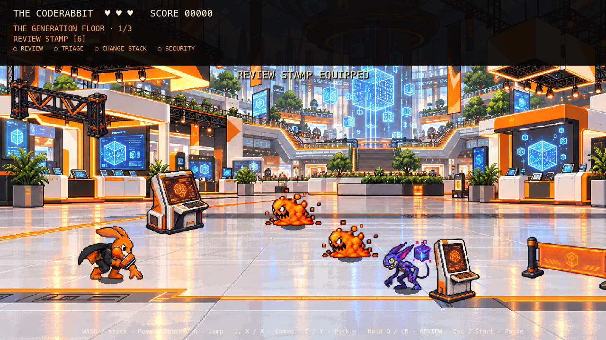
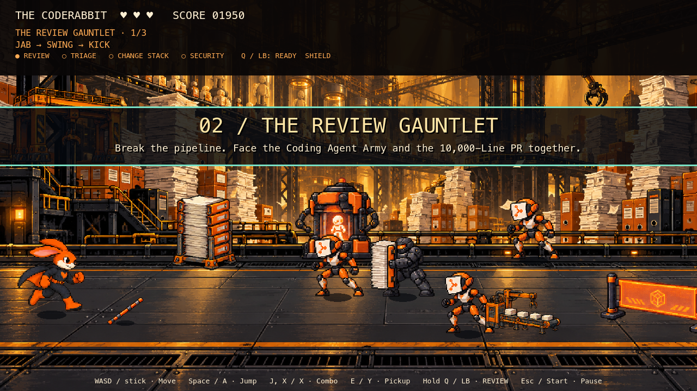
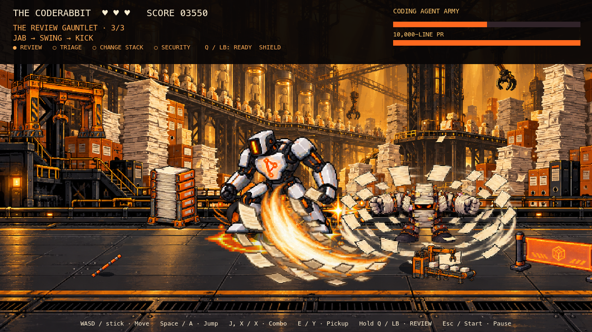
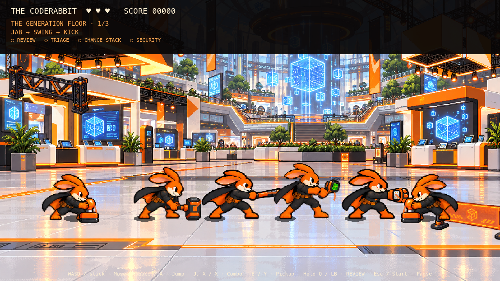

# Heroes vs. Villains — playable v1

Open `hoppys-adventure-arcade/project.godot` in Godot 4.7.1 and run **Beat’em Up → Play Heroes vs. Villains**. The direct scene is `res://scenes/beatem_up/reinvent/heroes_vs_villains.tscn`.

This mode uses the armored Hoppy and the [Mode 2 asset pack](heroes-vs-villains-assets.md). It has three stages, nine gated encounters, twelve enemy identities and four villains. Code City Brawl remains separately playable.



## Controls and run flow

| Action | Keyboard | Controller |
|---|---|---|
| Move along the ground plane | WASD / arrows | Left stick / D-pad |
| Jump | Space | A |
| Three-hit combo / weapon | J or X | X |
| Pick up weapon | E | Y |
| Charge REVIEW after unlock | Hold Q | Hold LB |
| Pause | Escape | Start |
| Skip presentation card | Enter / keypad Enter | View / Select |

The armored Hoppy uses eight-frame side, away and toward-camera locomotion cycles at 14 fps, with cadence scaled to analog movement and speed effects. Base travel speed is 264 pixels/second (10% above Code City Brawl).

Hoppy has three health points, jump avoidance, hit recovery and one shield on stage entry after REVIEW is unlocked. Attack presses can buffer the next combo strike. Clear ordinary rooms, then walk through the right gate. Boss encounters end with a short Hoppy victory hop while the defeated villain collapses, followed by the reward cards. After the last reward card, Hoppy runs out of the stage on his own under a CAPABILITY DEPLOYED banner, faster than his normal run when he starts far from the right edge, so he always leaves the screen before it fades. The screen dips to black while the next stage loads, then he runs in under its title banner and play resumes; the sequence takes about 2–3 seconds and needs no input. Messages raised while the title banner fades into combat, such as the encounter counter, wait until it clears. The opening cards lead into the same run-in, and so does a retry. Boss music dips, swaps tracks at the bottom and comes back up over 0.6 seconds. The final boss instead leads to the final victory cards and results. Break props for supplies; consumables collect on contact, while weapons require pickup input. Defeat retries the current stage with its entry score and capabilities, fresh health and cleared temporary effects. Pause and focus loss stop the run, including during cards and stage transitions; return-to-menu is available through pause and results.

Capabilities persist within the run, not across application launches. REVIEW unlocks after AI SLOP; TRIAGE and CHANGE STACK unlock after defeating both the fused army commander and the PR; SECURITY completes the final victory. Cards slide in and advance on their own after a hold: 4.5 seconds for the three opening cards, 3.0 seconds for boss cards, 4.5 seconds for unlock cards and 6.0 seconds for the final victory card. A bar under the hint drains with the remaining time. Enter, keypad Enter or controller View / Select skips the current card, once per press, after its first 0.25 seconds. Pause freezes the timer and preserves the pending card. Combat, pickup and jump inputs cannot dismiss cards. The results and game-over menus ignore confirm, click and touch input for their first 0.5 seconds, so a skip or jump press carried over from a card can't select an option. After that, the dedicated advance action confirms the focused button; jump / A does not.



## Stages and bosses

| Stage | Enemy roster | Environment and encounter |
|---|---|---|
| The Generation Floor | Slop Sprite, Hallucinated API Gremlin, Duplicate Logic Clone, Broken Test Bot | Code dumps and fog; terminals and kiosks. AI SLOP progresses through minions/melee, rushing barrages and LGTM shielding. |
| The Review Gauntlet | Agent Spawner, Change Stack Soldier, Review Blocker, Merge Request Mob | Falling stacks and overflow; PR monoliths and assembly lines. Three army clones fuse at half combined health, bringing in the independently damageable 10,000-Line PR. Both must fall. |
| The Agentic Core | AI Hacker Drone, Security Gap Crawler, Vulnerability Injector, Zero-Day Phantom | Scan lines and damage-triggered surges; security racks and nodes. The Hacker escalates through three phases, ending with a separate hidden attack vector. |

Clones split once. Test bots lose armor and periodically damage themselves. Soldiers block frontal attacks except finishers; blockers resist knockback. Spawner-owned mobs disappear with their source. Hidden enemies remain faintly visible and expose their attack warnings; scanning reveals them fully. Wounded phantoms can dodge by teleporting. Three timed ally types provide healing, spawner removal or scanning support.

Boss phase transitions clamp damage at their thresholds so heavy weapons cannot skip required phases. AI SLOP's final shield only activates while its minions remain; clearing the last one breaks it, and entering the phase with none cannot lock the encounter. The Hacker's second vector has independent movement and collision geometry while sharing its health pool.



## Capabilities and equipment

REVIEW requires a 0.45-second hold, grants a short invulnerability window and staggers nearby threats, then recharges for eight seconds. TRIAGE marks the highest-priority threat and adds one damage against it. CHANGE STACK finishers leave two-second damage zones. SECURITY is the concluding unlock and victory presentation.

| Weapon | Uses | Behavior |
|---|---:|---|
| Review Stamp | 6 | Wide stagger strike |
| Triage Hammer | 4 | Heavy single-target hit and temporary mark |
| Change Stack Baton | 5 | Long reach; destroys agent spawners immediately |
| Security Scanner | 8 | Reveals hidden enemies and the Hacker vector for ten seconds, including on a missed swing |
| PR Merger | 1 | Executes enemies below 25% health; staggers bosses on contact |

Each weapon has a baked sheet of the armored Hoppy holding it, so the grip, pixel scale and layering match the body; the hammer is held by its handle and the PR Merger is worn on the paw. With a weapon equipped, idle, side running, pickup and hurt play the sheet's `hold_idle`, `run`, `equip` and `hurt` clips, and the three combo steps play windup, contact and follow-through frames from the attack clock. Hit sparkles appear on the enemy; miss sparkles start at the weapon tip, and the scanner cone projects ahead of Hoppy. The contact trail is an arc around the paw for swings and slams, and a short streak behind the tip for thrusts and punches; it never crosses Hoppy's body. All of them mirror with facing. Walking toward or away from the camera, jumping, defeat and the victory pose draw a pixel-matched carry icon at the paw instead, behind the body in the back view. The scanner's carry is turned a quarter turn so its screen points forward rather than over Hoppy's face. Weapon reach, timing and effects on enemies are unchanged.



Health capsules, review shields, speed surges, score coins and randomized beneficial pickups supplement the weapons. Confusion and strength reduction come from enemy attacks; overload hazards apply an overwhelmed status. Durability, status timers, capabilities and boss health are displayed in the HUD.

The v1 resolves the source catalog's timing ambiguities with an eight-second REVIEW cooldown and ten-second scanner reveal. Health, wave sizes and timing live in mode-local scripts for subsequent playtest tuning.

## Audio

All requested tracks are wired from `Assets/Audio/Beat'em Up/Hero vs Villian/`:

| Encounter | File |
|---|---|
| The Generation Floor | `Hero Immortal.mp3` |
| AI SLOP | `8-bit_slay_the_evil.ogg` |
| The Review Gauntlet | `frivolous_hero.ogg` |
| Coding Agent Army / 10,000-Line PR | `Heavy Concept A Bass Master.wav` |
| The Agentic Core | `synth_type_mix2.ogg` |
| AI-Augmented Hacker | `Zodik - Lord of Zorg I.ogg` |

Each music stream is duplicated before enabling looping, including the WAV track. Music uses the Music bus; pooled impact/jump/pickup effects from Juhani Junkala's collection and the pack's eight original cues use SFX. Imported shared streams are never modified. Track provenance is recorded in `ASSETS_LICENSES.md`.

## Runtime and validation

The isolated runtime is in `modes/beatem_up/reinvent/`: `game.gd` manages rooms, hazards, props, cards, capabilities and cleanup; `player.gd`, `enemy.gd` and `boss.gd` manage actors; `catalog.gd` owns tuning/audio, the `FLOW` timings and the `CARD_HOLD` table; `art.gd` caches read-only frames and loads each armed sheet from `Assets/hoppy-armed/heroes/` on first use; `weapon_rig.gd` draws the carry icon, the contact trail and a fallback weapon cel from the attack clock. The stage exit and entry reuse Code City's clock-driven `modes/beatem_up/stage_flow.gd` unchanged. The mode uses ground-plane combat geometry with separate jump height and Y sorting. Normal spawns cap at twelve enemies, with two reserve slots for clone splitting; projectiles cap at 32, warnings at twelve, pickups at 24 and CHANGE STACK zones at six.

```sh
godot --headless --path hoppys-adventure-arcade --import
godot --headless --path hoppys-adventure-arcade --script res://tests/heroes_villains_assets.gd
godot --headless --path hoppys-adventure-arcade --script res://tests/heroes_villains_logic.gd
godot --headless --path hoppys-adventure-arcade --script res://tests/heroes_villains_motion.gd
godot --headless --path hoppys-adventure-arcade --script res://tests/heroes_villains_smoke.gd
godot --headless --path hoppys-adventure-arcade --script res://tests/stage_flow.gd
godot --headless --path hoppys-adventure-arcade --script res://tests/hoppy_armed_assets.gd
# Rendered traversal, card and weapon captures (macOS):
godot --path hoppys-adventure-arcade --always-on-top --script res://tests/heroes_villains_smoke.gd
godot --path hoppys-adventure-arcade --always-on-top --script res://tests/heroes_villains_motion.gd
```

The logic suite covers combat depth/deduplication, combo buffering, enemy defenses and special behaviors, all weapons, capability effects, hazards, pause, all boss transitions, independent PR defeat, shield edge cases, retry cleanup, the automatic stage exit after the unlock cards and all six music mappings. The smoke suite injects keyboard/controller events, traverses all nine encounters with no card or stage confirmation, checks bounded entity pools and capability retention, reaches one victory and returns to an unpaused menu. `hoppy_armed_assets.gd` requires all eleven armed sheets across both modes. Rendered runs save previews in `docs/previews/heroes-villains/`; `--always-on-top` keeps macOS from stalling the captures while the window is covered.

Godot 4.7.1 asset, logic and full-traversal checks passed, including a rendered traversal at 1280×720. On October 8, 2026, after the stage-flow and armed-sheet changes, all 26 headless CI suites passed; the rendered traversal finished with no card or stage confirmation, and the rendered `weapons_25/44/85` captures were compared against the sheet cells for all five weapons. Code City logic, motion and full-traversal regressions and menu-return layout checks also passed. The traversal bot uses invulnerability and accelerated navigation: it verifies reachability, not human difficulty balance. Physical controller feel, listening/mix QA, packaged exports and performance on target booth hardware remain playtest work. Locomotion uses the generated movement supplement; unarmed combat retains the original key poses, and armed poses come from the armed sheets. The motion suite verifies directional cycles, speed/cadence, each card's hold and auto-advance, single-press skip, pause freeze, the game-over overlay's input filter, and armed idle, attack frames, mirroring and the carry icon for every weapon.
